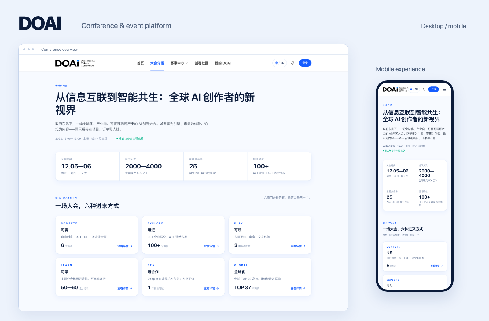

# yimi528 · Full-Stack Development Portfolio

[简体中文](README.md) / English · [GitHub](https://github.com/yimi528)

## DOAI · Global Maker Conference Website and Event Platform

I independently owned requirements, interface design, and full-stack development for DOAI, including account integration, database migrations, automated verification, and deployment support. The platform connects conference information, attendance applications, contest entries, forum reservations, team collaboration, and on-site check-in.

**[View the Case Study](projects/doai/README.en.md)** · [Implementation Details](projects/doai/IMPLEMENTATION.en.md) · **[Browse the Website Source](projects/doai/source/)**

### What I Built

- **Attendance and competition** workflows cover applications, forum reservations, digital passes, team registration, and project submissions.
- **Maker collaboration** includes team recruitment, join requests and invitations, card exchange, messaging, and privacy settings.
- **Event operations** supports application review, content and session management, channel-scoped permissions, data exports, and QR check-in.

### Engineering Details

- **Registration retries** use stable request IDs and server-side receipt lookup to handle duplicate submissions and lost responses.
- **Concurrent updates** use database transactions for booking availability, team size, and check-in status, plus version checks for concurrent edits.
- **Account and permission isolation** uses server-side sessions to identify the acting user and enforce permissions. The frontend isolates cached data and late responses after an account switch.

The React and TypeScript frontend uses Tailwind CSS and Vite. An Express same-origin proxy connects it to the main platform’s NestJS services, with Prisma and MySQL for persistence. The project supports deployment to Vercel and under the `/doai/` subpath.

The public source directory includes the website, same-origin proxy, test scripts, backend patches, and SQL migrations.

---

Portfolio documentation is licensed under <a href="LICENSE">Apache-2.0</a>. Rights to the project source code, branding, and third-party materials remain with their respective owners.
