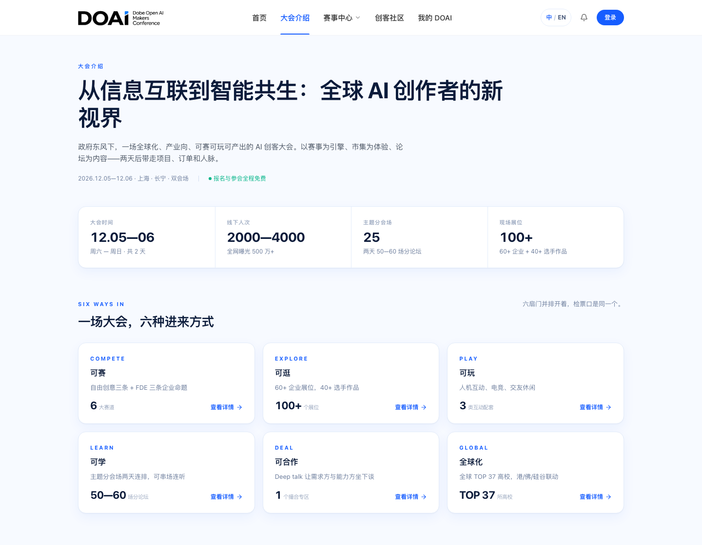

# yimi528 · Commercial Project Portfolio

[简体中文](README.md) | **English**

Real business projects I independently own and develop, covering requirements, page and interaction design, frontend and backend implementation, data persistence, system integration, deployment support, and automated verification.

These case studies show the interfaces, how business workflows are implemented, how the systems are structured, and the problems solved along the way, helping recruiters and interviewers assess my ability to deliver a complete project.

**Technologies:** React · TypeScript · Tailwind CSS · Node.js / Express · NestJS · Prisma · MySQL · Vercel · Puppeteer

[GitHub Profile](https://github.com/yimi528) · [Read the Full DOAI Case Study](projects/doai/README.en.md)

## Selected Projects

| Project | My Role | Full Scope | Details |
| --- | --- | --- | --- |
| DOAI Makers Conference Website and Event Platform | Sole developer responsible for the overall project and ongoing iterations | Conference website, contest registration and submissions, forum booking and digital tickets, teams and community, notifications, operations dashboard, DOAI backend services, database migrations, automated regression coverage, and release preparation | [Full Case Study](projects/doai/README.en.md) |

## Page Preview

[View conference, venue, partnership, sign-in, and mobile screenshots](projects/doai/README.en.md#screenshots). These show an earlier UI version; the full case study also covers subsequent business features and engineering work.

## What I Own

- **Requirements and interactions:** Translate conference materials into navigation and workflows for attendees, makers, partners, and operators.
- **Frontend implementation:** Build the public website, registration wizard, personal dashboard, and operations dashboard, including responsive layouts, bilingual content, feedback, and error recovery.
- **Backend and data:** Implement DOAI business APIs and authorization rules using NestJS, Prisma, and MySQL, with database migrations and supporting fixes.
- **Workflow reliability:** Handle registration retries and deduplication, account-switch isolation, ticket capacity and cancellation rules, team size limits, review notifications, and concurrent editing conflicts.
- **Engineering delivery:** Support Vercel and subpath deployment, and build browser regression suites, data-rule tests, isolated database verification, and release-package checks.

## About the Case Studies

Each case study covers business goals, my responsibilities, modules, architecture, engineering challenges, verification, and delivery status. The DOAI case study describes my ownership of the overall project, including later iterations in the current development version.

The original source code is private. This repository provides case-study documentation and screenshots. Implementation, test coverage, and production release status are described separately in each case study.

## License and Third-Party Rights

This repository retains the [Apache License 2.0](LICENSE) selected when it was created. The license applies only to content that may be distributed under it. It does not grant rights to the original project's private source code, third-party trademarks, or other third-party materials.
