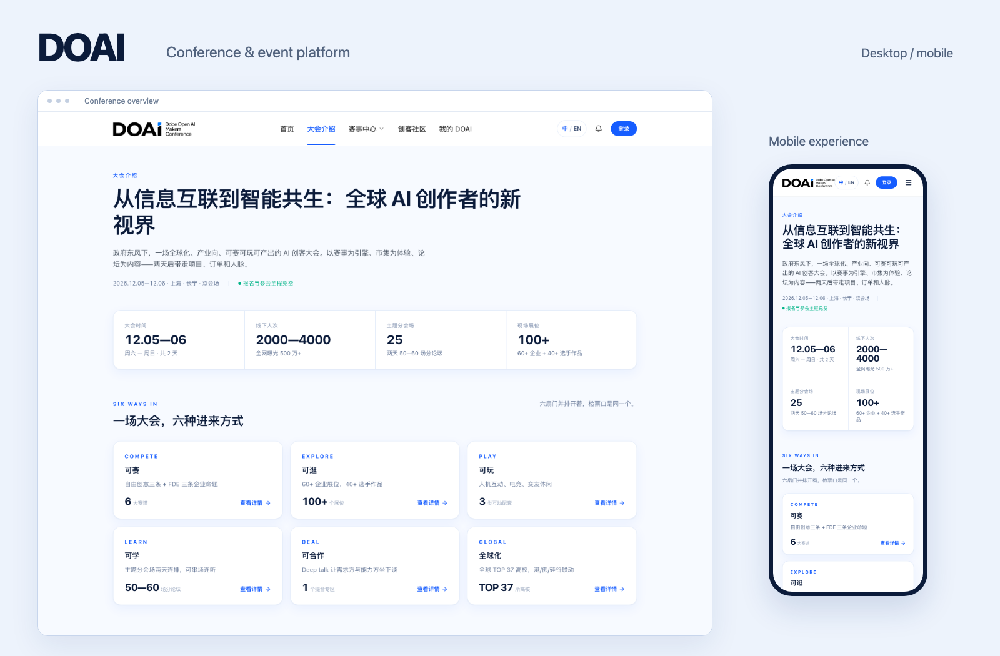

# yimi528 · 全栈开发作品集

简体中文 / [English](README.en.md) · [GitHub](https://github.com/yimi528)

## DOAI · 全球创客大会官网与活动平台

我独立负责 DOAI 的需求梳理、界面设计与全栈开发，包括主站账号接入、数据库迁移、自动化验证和部署适配。平台串联大会展示、参会申请、赛事报名、论坛预约、团队协作与现场核销。

**[查看项目案例](projects/doai/README.md)** · [实现详解](projects/doai/IMPLEMENTATION.md) · **[浏览网站源码](projects/doai/source/)**

### 交付范围

- **参会与参赛**包括参会申请、论坛预约、电子凭证、团队报名和作品提交。
- **创客协作**覆盖战队招募、入队申请与邀请、名片交换、消息和隐私设置。
- **运营后台**支持申请审核、内容与场次管理、渠道权限、数据导出和扫码核销。

### 关键工程实现

- **报名重试**通过稳定的请求标识和服务端回执查询处理重复提交与响应丢失。
- **并发与状态一致性**通过数据库事务维护预约名额、战队人数及核销状态，并用版本校验处理并发编辑。
- **账号与权限隔离**由服务端会话确认操作者并校验业务权限，前端在切换账号后隔离旧缓存和迟到响应。

前端使用 React、TypeScript、Tailwind CSS 和 Vite，通过 Express 同源代理接入主站的 NestJS 服务。业务数据由 Prisma 和 MySQL 持久化。网站支持 Vercel 和 `/doai/` 子路径部署。

公开的源码目录包含网站代码、同源代理、测试脚本及配套的后端补丁和 SQL 迁移。

---

作品集文档采用 <a href="LICENSE">Apache-2.0</a> 许可。项目源码、品牌及第三方素材的权利归各自权利人所有。
