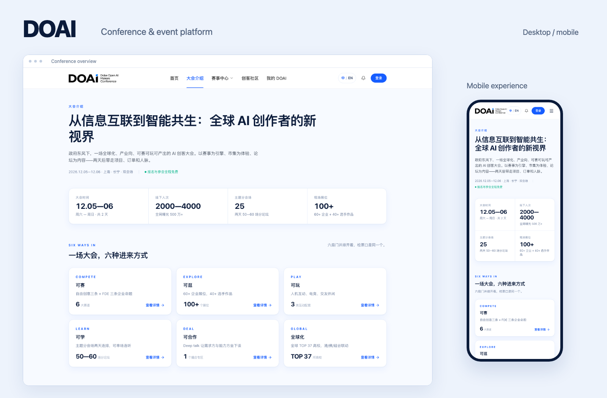

# yimi528

**独立全栈开发**

简体中文 / [English](README.en.md) &nbsp;&nbsp; [GitHub](https://github.com/yimi528)

把业务需求做成可用的产品。从页面与交互，到后端、数据库和交付工具，我独立负责项目的整体开发。

 

## DOAI

全球创客大会官网与活动业务平台

为参会者、创客和运营人员构建同一套活动平台，串联大会展示、赛事报名、论坛预约、组队协作和现场核销。

- **产品与界面**：官网、报名向导、数字 Passport、个人中心与运营后台。
- **业务与数据**：票务、战队、社区、消息、审核、权限和数据库持久化。
- **工程与交付**：并发与异常处理、自动化回归、部署适配和发布工具。

**[查看项目案例](projects/doai/README.md)** &nbsp;&nbsp; [完整开发详解](projects/doai/IMPLEMENTATION.md)

 

### 技术栈

`React` `TypeScript` `Tailwind CSS` `Vite`

`Node.js` `Express` `NestJS` `Prisma` `MySQL`

`Vercel` `Puppeteer`

### 我关注的开发工作

把参与者和运营人员的需求整理成完整流程，处理账号、权限、状态、并发和失败恢复，让界面与业务逻辑共同支撑产品使用。

本作品集保留页面实拍、完整工作范围与关键实现，方便在面试中进一步讨论设计选择和代码细节。

---

案例源码为私有。文档采用 <a href="LICENSE">Apache-2.0</a>；原项目私有源码、品牌及第三方素材的权利不在本仓库许可范围内。
