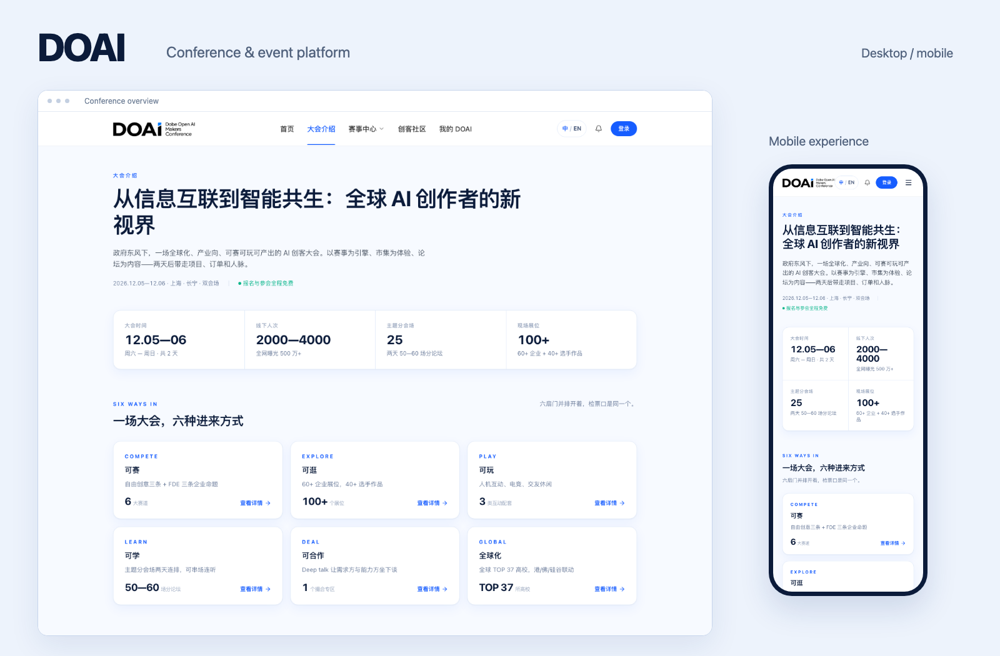
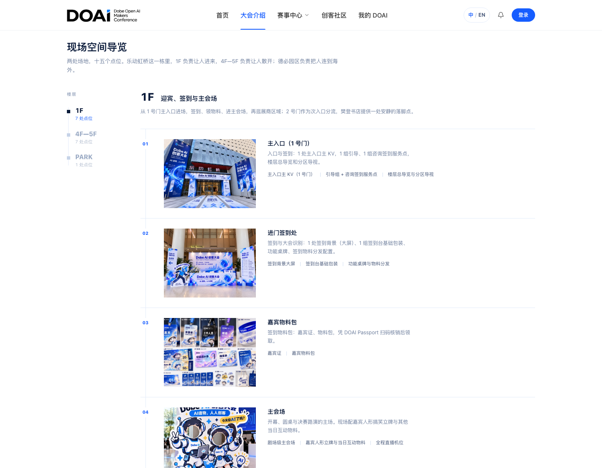
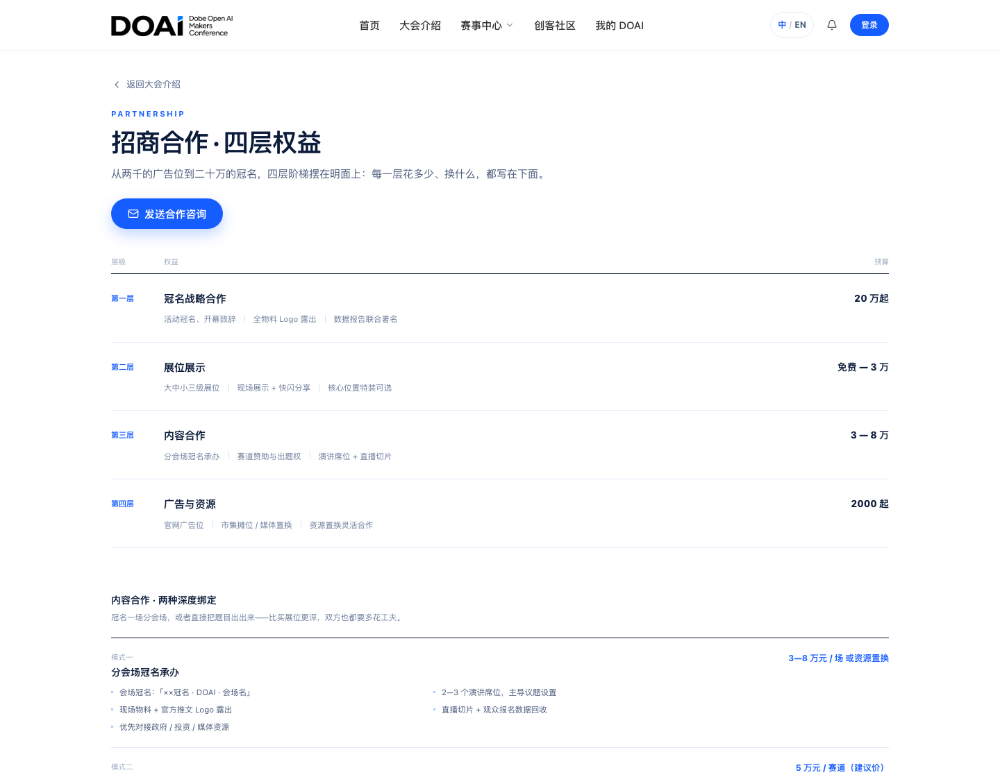
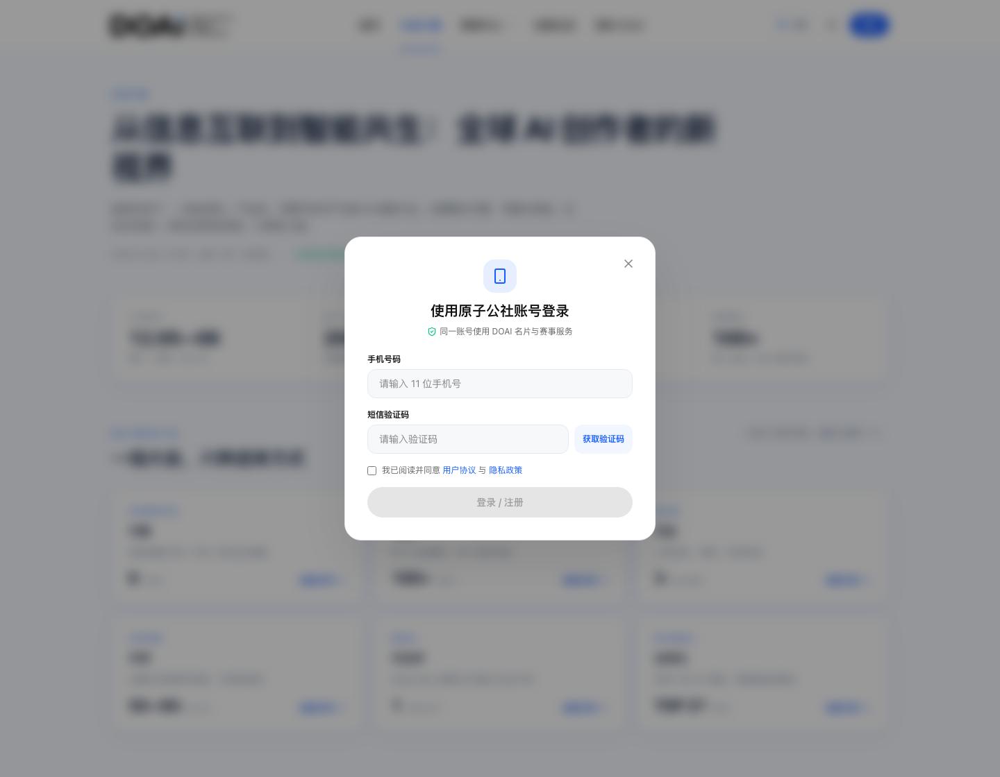

[Portfolio](../../README.en.md) / DOAI &nbsp;&nbsp; [简体中文](README.md) / English

# DOAI

### Conference website and event platform

I independently own the overall development and ongoing iterations, from requirements, pages, and interactions to backend workflows, databases, automated verification, and deployment support.

`React` `TypeScript` `NestJS` `Prisma` `MySQL` `Vercel`

[Desktop Original](images/conference-desktop.png) &nbsp; / &nbsp; [Mobile Original](images/conference-mobile.png) &nbsp; / &nbsp; **[Implementation Details](IMPLEMENTATION.en.md)**

## One Platform, Three Audiences

**Attendees** explore the conference, apply to attend, book forums, and receive digital tickets. **Makers** enter contests, submit work, build teams, and find collaborators. **Operators** review applications, maintain content and sessions, and run on-site check-in.

I brought these needs together into connected public and administrative workflows, integrated with the main platform's existing account system.

## What I Built

- **Conference website**: Homepage, contests, schedules, venue guide, partnerships, bilingual content, and mobile layouts.
- **Registration and tickets**: Multi-step registration, team links, submission updates, attendance review, forum bookings, digital tickets, and Passport.
- **Community and collaboration**: Recruitment, follows, card exchanges, team applications and invitations, profiles, and privacy settings.
- **Messages and operations**: Unified inbox, review notifications, CMS, forum management, channel permissions, exports, and QR check-in.
- **Backend and data**: NestJS workflows, Prisma / MySQL persistence, authorization, database migrations, and main-platform integration.
- **Quality and delivery**: Browser regression suites, isolated database verification, concurrency and failure recovery, deployment support, and packaging tools.

## Interface Gallery

<table>
<tr>
<td width="50%">

 <strong>Venue guide</strong> 
Content organized by venue and floor, with direct links from activity entry points.
</td>
<td width="50%">

 <strong>Partnerships</strong> 
Dedicated benefits and budget information, with a separate path for partners.
</td>
</tr>
</table>

View the sign-in interface

Integration with the existing account system, covering verification codes, sessions, profile mapping, and sign-in feedback.

## Key Implementation Decisions

**Confirm the outcome of each submission.** Registration uses request identifiers and receipt lookup to handle repeated clicks, timeouts, and lost acknowledgements. Saved states are validated before updating the interface.

**Keep concurrent work consistent.** Backend transactions manage booking capacity, team limits, and check-in state. Version checks protect CMS and forum edits, preserving drafts when conflicts occur.

**Keep identity and permissions explicit.** Server sessions identify actors, with separate owner, leader, channel, and administrator checks. The frontend isolates cached data and late responses from previous accounts.

### Architecture

The React / TypeScript frontend reaches NestJS services through an Express same-origin proxy. Prisma / MySQL persist business data, while the existing account service provides identity. Deployment supports Vercel and the `/doai/` subpath.

**[Read the Implementation Details](IMPLEMENTATION.en.md)** for all ten work areas, complete user workflows, architecture, tradeoffs, verification coverage, and a resume summary.

---

Screenshots show an earlier version, captured on November 2, 2026; the full scope includes later iterations. Some newer features still require coordinated database migrations and production releases. Attendance figures and partnership prices are event plans or proposals; venue images are illustrative.
