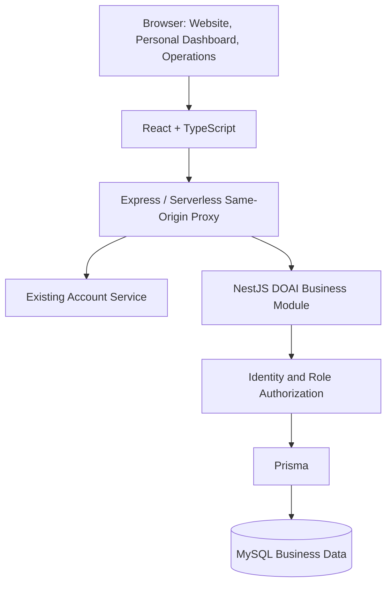

# DOAI Makers Conference Website and Event Platform

[简体中文](README.md) | **English**

> Sole developer responsible for the overall project and its iterations, spanning the conference website, registration and ticketing, maker community, operations dashboard, backend services, database work, testing, and release preparation.

[Back to Portfolio](../../README.en.md)

## Project Overview

| Item | Description |
| --- | --- |
| Business purpose | An event platform for conference promotion, contest organization, attendance booking, maker collaboration, and on-site operations |
| My role | Sole developer responsible for requirements, UI and interactions, frontend and backend workflows, integration with the main platform, persistence, automated verification, and deployment support |
| Users | Attendees, contestants, project owners, partners, reviewers, and on-site operators |
| Frontend | React 19, TypeScript, Vite, Tailwind CSS, lucide-react |
| Backend and data | Node.js / Express same-origin proxy; NestJS DOAI business module; Prisma / MySQL |
| Tickets and check-in | qrcode.react for QR codes, jsQR for camera scanning, plus scanner and manual check-in inputs |
| Engineering tools | Puppeteer browser regression suites, Node.js tests, isolated MySQL verification, and release-package and manifest checks |
| Scope of this case study | The overall project and current development version, including later iterations; some newer features still require coordinated production release |

## Business Goals and Workflows

The project combines a public conference website with the systems needed to participate in and operate the event. I translated conference materials into navigable content while implementing registration, teams, booking, tickets, reviews, and check-in workflows.

| User | Main Workflow |
| --- | --- |
| Attendee | Explore the event → choose attendance type or forum → apply or book → receive a digital ticket → check in |
| Contestant | Review challenges → sign in and provide details → register individually or as a team → submit or update work → view reviews and messages |
| Project owner or member | Publish recruitment → browse, like, and apply → handle applications or invitations → manage team membership |
| Maker | Publish a profile card → follow and follow back → exchange cards → manage cards and privacy in the personal dashboard |
| Operator | Access registrations within permission scope → review and notify → manage sessions and content → export data → check in attendees and view records |

## Screenshots

These are browser screenshots of a local preview of committed version `2e07d6c`, captured on November 2, 2026. Desktop screenshots use a 1440 × 1120 viewport; the mobile screenshot uses 390 × 1100. The screenshots retain the original Chinese interface and show an earlier UI version; the full development scope below includes subsequent iterations.

Attendance figures, exposure figures, and partnership prices shown on the pages are event plans or partnership proposals, not actual operating results or my development income. Venue images are illustrative assets used in the original pages.

### Conference Overview · Content Structure and Navigation

Organized the conference summary, dates, locations, and six ways to participate into sections and cards. Venue, contest, and partnership entry points lead to their respective pages.

### Venue Guide · Floor Navigation and Location Cards

Separated the venue guide from the conference overview, organized content by venue and floor, and supported links from activity entry points to specific floors. The screenshot shows floor navigation and location cards.

### Partnerships · A Dedicated Path for Partners

Moved partnership information out of the conference overview, presenting benefits and budgets by tier with a contact entry point.

### Sign-In · Integration with the Existing Account System

Connected the phone-number and verification-code sign-in flow, including agreement confirmation, code requests, and sign-in feedback. The screenshot shows an empty, unsubmitted form.

### Mobile · Conference Overview at a Narrow Viewport

The same conference overview on a mobile viewport, showing navigation, the summary, information cards, and participation entry points.

## Full Development Scope

### 1. Requirements, Content Structure, and UI Interactions

- Turned conference and partnership materials into the homepage, overview, contest section, venue guide, forums, and partnership pages, with paths for different audiences.
- Built navigation, footer, cards, detail-page layouts, dialogs, drawers, and personal dashboard interfaces, with desktop and mobile layouts.
- Separated the conference overview, floor-by-floor venue guide, and partnership information, linking activities directly to relevant venue floors.
- Maintained bilingual copy, schedules, dates, and venue information, including legacy routes, return navigation, scrolling behavior, and sharing metadata.

### 2. Account Integration, Identity, and Profiles

- Integrated the existing main platform's SMS sign-in, current-account lookup, and sign-out, mapping account profiles into the conference user model.
- Implemented same-origin forwarding and session handling for both independent deployment and subpath deployment.
- Handled session restoration, cross-tab synchronization, explicit sign-out, and account switching, isolating stale responses and cached data from previous accounts.
- Built nickname editing, avatar upload with cropping and compression, profile synchronization, public-card settings, and card-exchange permissions, updating UI state after validating save acknowledgements.

### 3. Contest Registration, Team Entries, and Submissions

- Built track and challenge pages, a multi-step registration wizard, open/closed eligibility checks, and forms for applicant details, project descriptions, and submission links.
- Supported individual and team registration, linking newly created or existing teams with member, leader, and invitation information.
- Designed request identifiers and receipt lookup for registration, handling double clicks, timeouts, lost acknowledgements, retries, and content comparison.
- Implemented registration lists and details, review status, supplementary materials, and submission updates, preserving input and offering retries on failure.
- Added registration-channel tracking and channel-scoped operations, with supporting field migrations, API authorization, and filtering.

### 4. Attendance Applications, Forum Booking, and Digital Tickets

- Built attendance-type and session selection, applications requiring review such as media and industry attendance, and review and ticket-status displays.
- Implemented forum lists and details, categories and schedules, bookmarks, booking, cancellation, and personal ticket views.
- Connected publication status, booking switches, end times, capacity, and cancellation rules, using backend transactions to handle capacity and concurrent bookings.
- Built the digital Passport and QR tickets, linking registration, booking, review, and check-in status.
- Handled partial success across multiple bookings, retries, ticket refreshes, and stale responses after account changes.

### 5. Teams, Recruitment, and Maker Cards

- Built team creation, editing, member removal, leaving, and dissolution, plus join applications, leader invitations, acceptance, and rejection.
- Enforced team permissions, mutual-follow conditions, size limits, and concurrent joining rules, keeping notifications and membership data consistent.
- Implemented recruitment publishing, filtering, details, likes, applications, and owner responses, storing role, skill, stage, and collaboration preferences.
- Built the card wall, following and mutual follows, reciprocal card exchanges, and the personal card collection, connected to privacy settings.
- Handled repeated likes, applications and exchanges, failed list loading, draft preservation, and legacy links.

### 6. Notifications and Business Messages

- Unified contest reviews, team invitations and applications, card exchanges, ticket check-ins, and official announcements.
- Built a notification drawer, personal inbox, unread counts, and individual and bulk read actions confirmed through save acknowledgements.
- Supported handling team applications and invitations within messages, updating related team and notification state after actions.
- Handled concurrent incoming messages and read actions, retries, legacy notification links, and account-switch isolation.

### 7. Operations Dashboard, Permissions, and On-Site Check-In

- Built registration and attendance reviews, submission and applicant inspection, feedback, result notifications, statistics, and CSV export.
- Implemented forum creation and editing, bilingual fields, speakers, Shanghai-time scheduling, capacity, draft/publish/unpublish states, and booking switches.
- Built homepage CMS settings, announcements, displayed metrics, livestream-link configuration, recruitment moderation, and broadcast notifications.
- Implemented administrator lists, grants and deactivation, plus channel-scoped operations, with backend authorization for sensitive actions.
- Built camera scanning, hardware-scanner input, and manual check-in, sharing a submission lock and requiring a valid acknowledgement before showing success.
- Organized dashboard navigation into registration and on-site work, content and publishing, and permissions, with mobile selectors and layouts.

### 8. Backend Services, Database, and Main-Platform Integration

- Developed DOAI workflows for registration, tickets, check-in, teams, recruitment, follows, cards, messages, profiles, CMS, and administration within the existing NestJS platform.
- Persisted business data with Prisma and MySQL, writing SQL migrations and cumulative backend patches with coordinated version and migration ordering.
- Used the main platform's account service as the identity authority, deriving actors from server-side sessions and checking owner, leader, project-owner, and administrator permissions.
- Used transactions, unique constraints, and state checks for registration deduplication, team limits, reciprocal card uniqueness, forum capacity, and check-in notifications.
- Added version checks for CMS and forum editing, returning conflicts while the frontend preserves drafts and supports explicit reloads.

### 9. Deployment Support and Release Tools

- Configured Vite builds, Vercel static hosting and Serverless proxying, supporting both root paths and the `/doai/` subpath.
- Handled nested API paths, upstream configuration, path validation, error propagation, and session forwarding in deployment environments.
- Provided local production previews, read-only production checks, current-build asset checks, and release-restoration verification.
- Built packaging tools that collect frontend assets, backend patches, migration SQL, verification reports, and a release manifest, checking package contents with file hashes.

### 10. Automated Testing and Regression Coverage

- Wrote data and business-rule tests, alongside Puppeteer regression scripts for desktop and mobile browsers.
- Intercepted business APIs in browser tests to cover normal workflows, loading failures, slow responses, repeated actions, save failures, refresh recovery, and account switching.
- Provided isolated temporary MySQL verification for persistence and concurrency, including repeatable migrations, team limits, exchange uniqueness, permissions, and capacity rules.
- Kept production checks read-only, separated database checks from browser fixtures, and made release tools check that verification reports match the current build.

## System Architecture

The frontend handles interactions and state presentation. Express provides same-origin forwarding and deployment compatibility. NestJS owns business rules, authorization, and transactions, while Prisma and MySQL persist business state. The existing account service is reused; I developed and integrated the DOAI business functionality.

## Key Engineering Problems and Solutions

| Problem | Implementation |
| --- | --- |
| A registration is saved but its acknowledgement is lost, making retries risky | Use request identifiers, server-side receipt lookup, and content comparison; clear submission state only after confirming the saved result |
| An old request returns after switching accounts | Validate account snapshots and session revisions, isolate caches and request locks by identity, and recheck identity before applying results |
| Concurrent team joins or bookings exceed capacity | Check membership or ticket counts within backend transactions, combining unique constraints with serializable transactions |
| Operators overwrite each other's edits | Include the read version when saving CMS and forum data, preserve drafts on conflict, and require explicit reloads |
| Repeated actions or failed responses are shown as successful | Use submission locks and validate returned objects, ownership, target states, or audit records before reporting success |
| Hidden UI controls do not enforce authorization | Derive actors from server sessions and separately authorize personal data, teams, channels, and administrative actions |
| Frontend, backend, and database versions do not match | Define migration and release order, provide capability and acknowledgement checks, and package release files with a manifest and hashes |

## Verification Coverage and Engineering Deliverables

| Area | Verification or Deliverables Written |
| --- | --- |
| Identity and profiles | Session restoration, sign-out, account switching, synchronization, privacy, and avatar regression checks |
| Registration and attendance | Registration retries, submission updates, team links, channels, attendance review, and export checks |
| Forums and on-site work | Bookmarks, booking and cancellation, session management, statistics, and all three check-in inputs |
| Community and messages | Recruitment, follows, cards, invitations, read-state updates, and failure recovery |
| Operations and concurrency | CMS publishing, permission isolation, editing conflicts, forum capacity, and team limits |
| Data and releases | Backend patches, SQL migrations, isolated MySQL verification, build checks, packaging, and restoration tools |

Browser regression checks use isolated API fixtures, and database verification uses separate temporary environments. Production acceptance is performed separately as part of the release process.

## Development and Delivery Status

This case study describes the current implementation. Deployment support is in place for the website. Some later business features, channel permissions, and forum-management iterations still require coordinated business-database migrations, Prisma Client generation, backend and frontend releases, followed by production acceptance.

The screenshots show earlier versions of the conference overview, venue guide, partnership page, and sign-in interface. The full scope also includes the personal dashboard, business APIs, operations dashboard, and engineering tools described above. Livestream access and unannounced content are enabled according to event preparation status.

## Resume Summary

Independently developed the DOAI conference website and event platform using React, TypeScript, NestJS, Prisma, and MySQL. Built contest registration and submissions, forum booking and digital tickets, teams and maker community, notifications, and an operations dashboard. Implemented session and permission isolation, idempotent registration, capacity constraints, and concurrent-edit protection, supported by browser regression suites, isolated database verification, and deployment and release tools.
