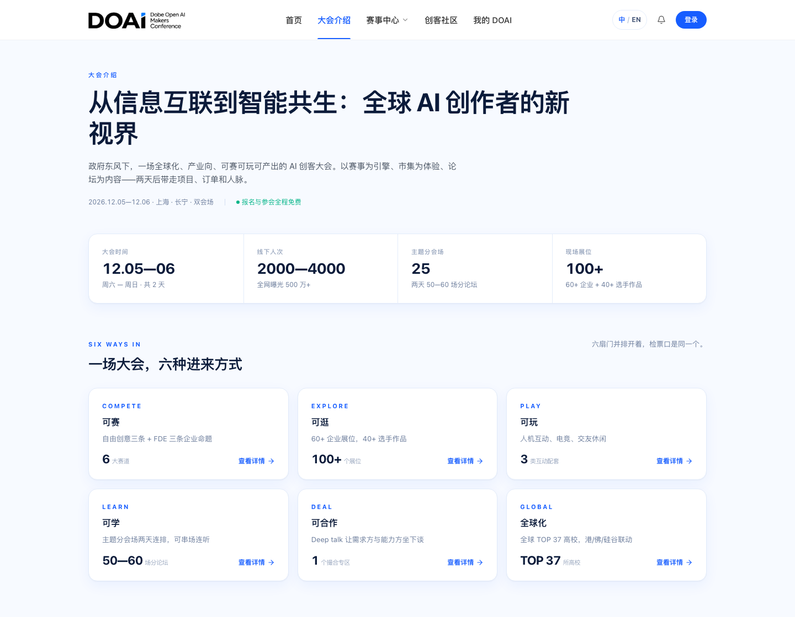
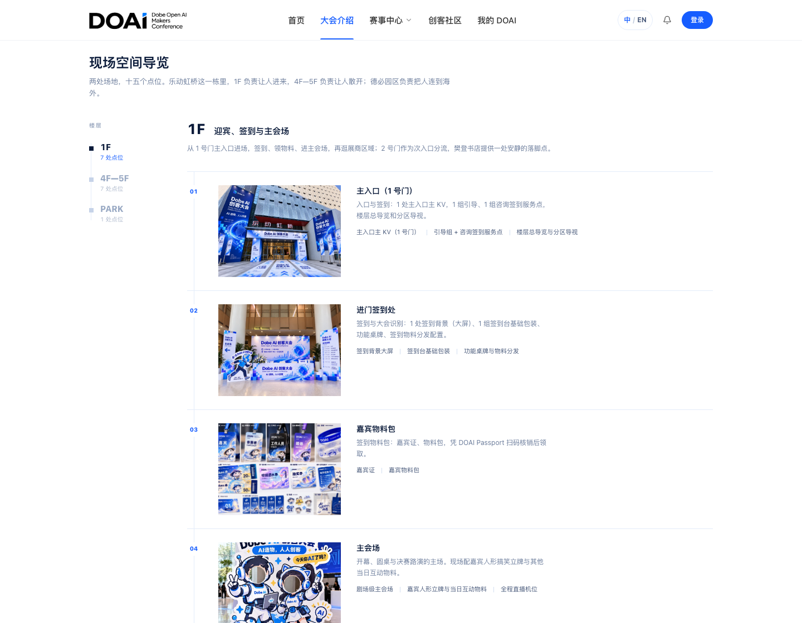
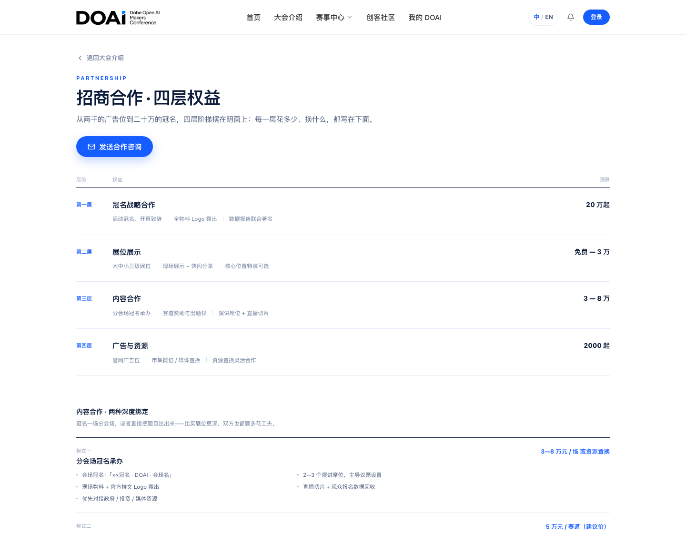
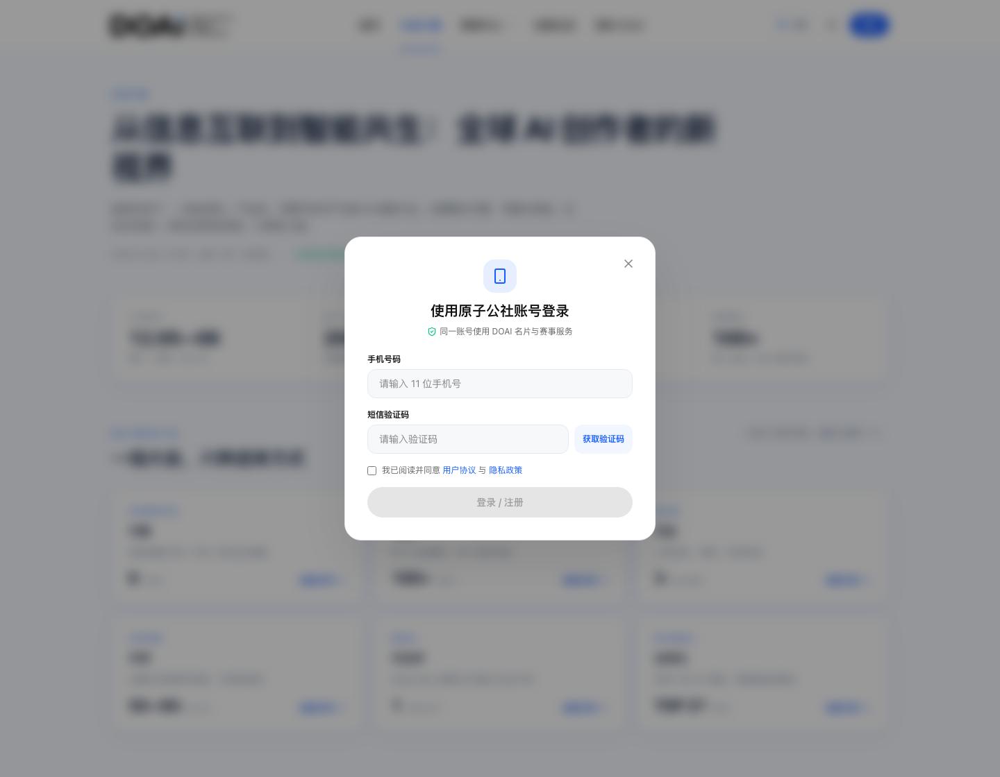
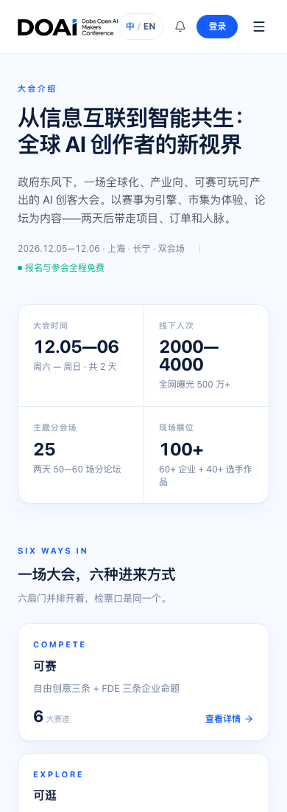
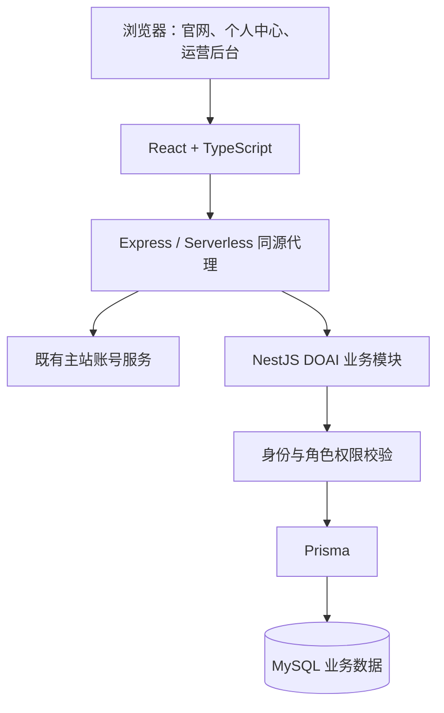

# DOAI 全球创客大会官网与活动业务平台

**简体中文** | [English](README.en.md)

> 由我独立负责整体开发与迭代，覆盖大会官网、报名与票务、创客社区、运营后台，以及配套后端、数据库、测试和发布准备。

[返回作品集](../../README.md)

## 项目概览

| 维度 | 说明 |
| --- | --- |
| 业务定位 | 服务大会宣传、赛事组织、参会预约、创客协作和现场运营的活动平台 |
| 我的角色 | 独立开发，负责需求梳理、页面与交互实现、前后端业务、主站集成、数据持久化、自动化验证及部署适配 |
| 服务对象 | 参会者、参赛创客、项目发起人、合作方、审核人员和现场运营人员 |
| 前端 | React 19、TypeScript、Vite、Tailwind CSS、lucide-react |
| 后端与数据 | Node.js / Express 同源代理；NestJS DOAI 业务模块；Prisma / MySQL |
| 票务与现场 | qrcode.react 生成二维码，jsQR 识别摄像头扫码，支持扫码枪及手动核销 |
| 工程工具 | Puppeteer 浏览器回归、Node.js 测试、隔离 MySQL 验证、发布包与清单校验 |
| 当前说明范围 | 整体项目及当前开发版本，涵盖后续迭代；部分新功能仍需配套生产发布 |

## 业务目标与完整流程

这个项目既承担大会对外展示，也承载活动参与和运营流程。我将大会资料转化为可浏览的内容结构，同时实现报名、组队、预约、凭证、审核和现场核销所需的业务系统。

| 用户 | 主要流程 |
| --- | --- |
| 普通参会者 | 了解大会 → 选择参会类型或论坛 → 提交申请／预约 → 获取电子凭证 → 现场核销 |
| 参赛创客 | 查看赛题 → 登录并填写资料 → 个人／团队报名 → 提交或更新作品 → 查看审核与消息 |
| 项目发起人与成员 | 发布招募 → 浏览、点赞和申请 → 处理申请／组队邀请 → 管理战队与成员 |
| 创客之间 | 公开名片 → 关注与互关 → 双向交换名片 → 在个人中心管理名片与隐私 |
| 运营人员 | 按权限查看报名 → 审核与通知 → 管理场次和内容 → 导出资料 → 扫码核销与查看记录 |

## 页面截图

以下为原项目已提交版本 `2e07d6c` 的本地浏览器实拍，截图日期为 2026-11-02。桌面端视口为 1440 × 1120，手机端视口为 390 × 1100。截图保留原项目的中文界面，记录早期页面版本；下文的完整开发说明覆盖后续迭代。

页面中的参会规模、曝光量及招商金额属于活动规划或合作方案，不代表实际运营结果或我的开发收入；场地图为页面中的示意素材。

### 大会介绍 · 信息分组与访问入口

将大会概要、时间地点和六种参与方式组织成分区与卡片；场地、赛事和合作入口分别指向对应页面。

### 场地导览 · 楼层切换与点位卡片

从大会介绍拆出独立导览页，按场地和楼层组织内容，并支持从活动入口深链到具体楼层。截图展示楼层切换与点位卡片区域。

### 招商合作 · 独立的合作方访问路径

将合作方案从大会介绍页拆出，按合作层级展示权益与预算，并提供咨询入口。

### 账号登录 · 接入既有账号体系

接入手机号与验证码登录流程，并提供协议确认、发送验证码和登录反馈等界面。截图为未填写、未提交的登录状态。

### 手机端 · 大会介绍页的窄屏展示

同一大会介绍页在手机视口下的展示，包括导航、概要信息、指标卡片与参与入口。

## 完整开发工作

### 1. 需求梳理、内容结构与界面交互

- 将大会介绍与招商资料拆解为首页、大会介绍、赛事中心、场地导览、论坛、合作方案等模块，组织不同用户的访问路径。
- 实现品牌导航、页脚、卡片、详情页壳、弹窗、抽屉与个人中心等页面和组件，处理桌面端与手机端布局。
- 将大会介绍、双场地逐层导览和合作方案拆为清晰的页面，建立活动入口与场地楼层之间的深链。
- 维护中英文文案、日程、日期与场地信息，处理旧路由兼容、返回路径、页面滚动及分享元信息。

### 2. 账号接入、身份与个人资料

- 接入既有主站的手机号验证码登录、当前账号读取与退出流程，将账号资料映射到大会用户模型。
- 实现同源请求转发及会话处理，让独立部署的网站和子路径部署均能接入主站账号服务。
- 处理刷新后的登录恢复、跨标签页状态同步、主动退出和账号切换，隔离旧账号的迟到响应与缓存。
- 实现昵称、头像上传与裁剪压缩、主站资料同步、名片公开与交换权限等设置，并校验保存回执后再更新界面。

### 3. 赛事报名、团队报名与作品提交

- 实现赛道与命题展示、分步骤报名向导、开放／关闭状态判断，以及申请人资料、项目说明和作品链接采集。
- 支持个人与团队报名，关联创建或已有战队，维护成员、队长、邀请与团队信息。
- 为报名提交设计请求标识和回执查询，处理重复点击、请求超时或回执丢失后的安全重试与内容核对。
- 实现报名列表与详情、审核状态、补充材料、作品提交与更新，失败时保留输入并提供重试。
- 增加报名渠道记录与按渠道管理能力，配套字段迁移、接口授权与运营筛选。

### 4. 参会申请、论坛预约与电子凭证

- 实现参会类型选择、场次选择、媒体／行业等需审核的申请，以及审核结果与票据状态展示。
- 实现论坛列表与详情、分类与排期、收藏、预约、取消和个人凭证展示。
- 对接场次发布状态、预约开关、结束时间、名额及取消规则；后端以事务处理容量与并发预约。
- 实现数字 Passport 与二维码凭证，关联报名、预约、审核和核销状态。
- 处理多场次预约部分成功、失败后的重试、票据刷新和换号后的旧响应隔离。

### 5. 战队、招募与创客名片

- 实现建队、编辑、成员移除、退出与解散，以及加入申请、队长邀请、接受和拒绝流程。
- 处理组队权限、互关条件、人数上限及并发加入冲突，维护相关通知与成员数据。
- 实现项目招募发布、筛选、详情、点赞、申请与发起人处理反馈，保存角色、技能、阶段和协作方式。
- 实现名片墙、关注／互关、双向名片交换与个人名片盒，并联动资料隐私设置。
- 处理重复点赞、申请和交换、列表加载失败、草稿保留与旧链接跳转等情况。

### 6. 消息中心与业务通知

- 统一呈现赛事审核、组队邀请与申请、名片交换、票务核销和官方公告等通知。
- 实现消息抽屉、个人消息中心、未读数量、单条与批量已读，并通过保存回执确认状态。
- 支持在消息内处理组队申请／邀请，并在操作后更新相关战队与消息状态。
- 处理新消息与已读操作并发、请求失败重试、通知链接兼容及账号切换隔离。

### 7. 运营后台、权限与现场核销

- 实现报名与参会申请审核、作品与资料查看、审核意见、结果通知、统计与 CSV 导出。
- 实现论坛场次新增与编辑、中英文字段、嘉宾、上海时间排期、名额、草稿／发布／下架及预约开关管理。
- 实现首页 CMS 配置、公告、展示指标、直播链接配置、招募内容管理与全员站内信推送。
- 实现管理员名单、授权与停用，以及渠道运营范围控制；敏感业务由后端复核权限。
- 实现摄像头扫码、扫码枪与手动输入三种核销方式，共用提交锁，校验有效核销回执后显示成功。
- 按“报名与现场、内容与发布、权限管理”组织后台导航，提供手机端功能选择与适配布局。

### 8. 后端业务、数据库与主站集成

- 开发 DOAI 的报名、票务、核销、战队、招募、关注、名片、消息、资料、CMS 与管理相关业务，集成到既有 NestJS 主站。
- 通过 Prisma / MySQL 持久化业务数据，编写配套 SQL 迁移和后端累计补丁，处理版本配套与迁移顺序。
- 将主站账号服务作为身份来源，业务写入从服务端会话确定操作者，按本人、队长、发起人或管理员等角色校验权限。
- 为报名去重、团队人数限制、名片唯一性、论坛容量、核销与通知等场景处理事务、唯一约束和状态一致性。
- 为 CMS 和论坛编辑提供版本校验，冲突时返回明确错误，由前端保留草稿并支持重新读取。

### 9. 部署适配与发布工具

- 配置 Vite 构建、Vercel 静态资源与 Serverless 同源代理，并支持根路径和 `/doai/` 子路径。
- 处理部署环境中的 API 多级路径兼容、上游地址配置、请求路径校验、错误透传和会话转发。
- 提供本地生产预览、线上只读检查、当前构建资源校验和发布恢复检查入口。
- 编写发布打包工具，整理前端产物、后端补丁、迁移 SQL、验收报告与发布清单，并以文件哈希核对包内容。

### 10. 自动化测试与回归保障

- 编写数据与业务规则测试，以及使用 Puppeteer 的桌面端、手机端浏览器回归脚本。
- 在浏览器测试中拦截业务 API，覆盖正常流程、加载失败、慢响应、重复操作、保存失败、刷新恢复和账号切换。
- 为涉及持久化和并发的业务提供独立临时 MySQL 验证，覆盖迁移重复执行、组队人数限制、交换唯一性、权限及容量规则。
- 对生产检查使用只读模式；数据库验证与浏览器模拟验证分别执行，发布工具检查验证报告是否对应当前构建。

## 系统架构

前端负责交互和状态呈现；Express 负责同源转发与部署兼容；NestJS 承载业务规则、权限及事务；Prisma / MySQL 保存业务状态。主站已有账号服务被复用，DOAI 的业务功能由我开发并完成集成。

## 关键工程问题与处理方式

| 问题 | 实现方式 |
| --- | --- |
| 报名提交成功但回执丢失，重试可能重复报名 | 使用请求标识、服务端回执查询与内容比对，确认已保存结果后再清理提交状态 |
| 换号后旧请求返回，污染新账号界面 | 使用账号快照与会话版本校验，按身份隔离缓存与请求锁，在应用结果前重新确认身份 |
| 多人同时组队或预约，突破人数上限 | 后端事务内检查成员或票据数量，结合唯一约束与串行化事务处理竞争 |
| 多名运营人员同时编辑，覆盖彼此内容 | CMS 与论坛保存携带读取版本，冲突保留草稿，并要求明确重新加载服务器版本 |
| 重复点击或失败响应被当作成功 | 提交锁防重复操作，并校验返回对象、所属账号、目标状态或审计记录后再提示成功 |
| 页面隐藏入口无法代替业务授权 | 服务端从会话确定操作者，对本人数据、战队、渠道与管理操作分别做权限校验 |
| 前后端与数据库发布版本不匹配 | 整理迁移和发布顺序，提供能力／回执校验、只读检查及带清单和哈希的发布包 |

## 验证覆盖与工程交付物

| 范围 | 已编写的验证或交付内容 |
| --- | --- |
| 身份与资料 | 登录恢复、退出、换号、资料同步、隐私与头像相关回归 |
| 报名与参会 | 报名重试、作品更新、团队关联、渠道、参会审核与导出校验 |
| 论坛与现场 | 收藏、预约与取消、场次管理、统计及三种核销入口验证 |
| 社区与消息 | 招募、关注、名片、邀请、消息已读及失败重试回归 |
| 运营与并发 | CMS 发布、权限隔离、并发编辑冲突、论坛名额与组队人数验证 |
| 数据与发布 | 后端补丁、SQL 迁移、隔离 MySQL 验证、构建检查、发布包及恢复校验工具 |

浏览器回归使用隔离接口，数据库验证使用独立临时环境；生产验收按发布流程单独执行。

## 当前开发与交付状态

本案例覆盖当前开发实现。官网已有部署适配，后续业务、渠道权限、论坛管理等迭代中，部分功能仍需按顺序执行业务库迁移、更新 Prisma Client、发布主站后端并配套发布前端，再完成生产验收。

现有截图记录早期界面版本，展示大会介绍、场地导览、合作页与登录等页面；完整开发工作还包含上述个人中心、业务接口、运营后台和工程工具。直播入口及待官宣内容按筹备状态开放。

## 简历项目描述

独立负责 DOAI 大会官网与活动业务平台的全栈开发，使用 React、TypeScript、NestJS、Prisma 和 MySQL 实现赛事报名与作品提交、论坛预约与电子票、组队与创客社区、消息中心及运营后台；处理会话与权限隔离、报名幂等、容量约束和并发编辑，并配套浏览器回归、隔离数据库验证及部署发布工具。
